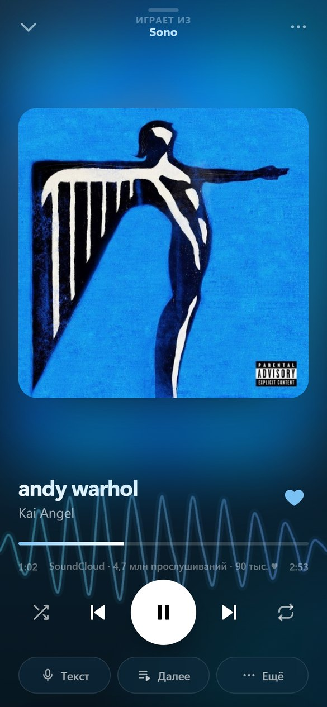
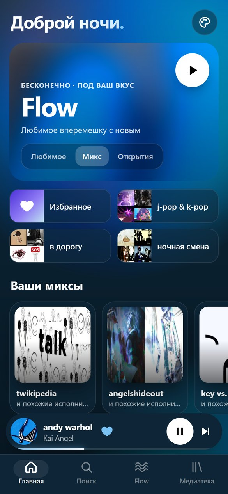

<p align="center"></p>

<p align="center">
  <a href="https://github.com/graveyarr/sono/releases/latest"></a>
  &nbsp;
  <a href="https://github.com/graveyarr/sono/releases/latest"></a>
</p>
<p align="center"><sub>Бесплатно и без рекламы · Windows 10/11 и Android 8+ · <a href="https://graveyarr.github.io/sono/">сайт Sono</a> · <a href="https://github.com/graveyarr/sono-themes">мастерская тем</a></sub></p>

# Sono

Минималистичный музыкальный плеер для Windows и Android в духе Spotify. Ищет треки на **YouTube** или **SoundCloud** и сразу их проигрывает, без аккаунтов и рекламы.

<table>
  <tr>
    <td width="50%"><br><sub><b>Ссылка из Spotify, Яндекса, Apple Music</b> — вставили в поиск, и трек играет</sub></td>
    <td width="50%"><br><sub><b>Страница трека</b> — кто спродюсировал, когда вышел, текст и похожие</sub></td>
  </tr>
  <tr>
    <td><br><sub><b>Темы</b> — «Алукард», «web angel», «2010», «Хром» и свои</sub></td>
    <td><br><sub><b>Визуализация</b> — пять видов, в цвет обложки</sub></td>
  </tr>
</table>

<p align="center">
  
  
  
</p>

## Установка

### Windows

1. Скачайте `SonoSetup-….exe` в разделе **[Releases](../../releases/latest)** (или кнопкой выше).
2. Запустите его и нажмите «Далее» → «Установить». Права администратора не нужны: программа ставится в вашу папку пользователя, как Spotify.
3. Готово: Sono появится в меню «Пуск» и на рабочем столе.

> **Windows может предупредить «Система Windows защитила ваш компьютер».** Так бывает со всеми программами без платной цифровой подписи. Нажмите **«Подробнее» → «Выполнить в любом случае»**.

Нужна **Windows 10 или 11 (64-бит)**. Всё остальное уже внутри установщика. Если в системе нет компонента Microsoft Edge WebView2 (в Windows 11 он есть всегда), установщик предложит его скачать.

Удаление: «Параметры» → «Приложения» → Sono → «Удалить». Программа спросит, стереть ли ваши плейлисты, или оставить их на случай повторной установки.

### Android

1. На телефоне откройте **[Releases](../../releases/latest)** и скачайте `SonoAndroid-….apk`.
2. Откройте скачанный файл. Телефон спросит, можно ли ставить приложения из браузера, — разрешите (Sono нет в Google Play, поэтому так).
3. Если появится «Play Защита» — нажмите «Подробнее» → «Всё равно установить».

Нужен **Android 8 или новее** (64-битный телефон — таких сейчас почти все). Встроенного обхода блокировок на телефоне нет: если SoundCloud или YouTube не открываются, включите VPN. Медиатеку можно перенести с компьютера: «Настройки → Медиатека → Резервная копия → Сохранить» на ПК, перекинуть файл на телефон и там — «Настройки → Медиатека → Восстановить из файла…».

## Возможности

- Поиск на YouTube или SoundCloud (на компьютере — и сразу на обоих: «Искать на: Везде»; на телефоне источник переключается кнопкой в строке поиска). **Ищет сам, пока вы печатаете** (Enter не нужен); треки исполнителей, которых вы слушаете, поднимаются выше и помечены «в вашем вкусе»
- **Поиск по строчке из песни**: помните кусок текста, но не название — введите его в поиск («и снится нам не рокот космодрома»), и над результатами появится сама песня («Трава у дома» — Земляне) с найденной строчкой. Работает через поиск Яндекс Музыки, строчка сверяется с текстом из LRCLIB
- **Ссылка из любого сервиса в поиске**: вставьте ссылку Spotify, Яндекс Музыки, Apple Music, Deezer, YouTube или SoundCloud. Трек — сразу можно включить (Sono найдёт ту же запись, а не ремикс или лайв); альбом и исполнитель — откроются их страницы в Sono; плейлист — одной кнопкой переносится в медиатеку. Короткие ссылки (spotify.link, link.deezer.com, on.soundcloud.com) тоже подходят
- **Кнопка «+ Sono» в браузере** («Настройки → Медиатека → Из браузера»): закладка на панели браузера — на странице трека YouTube или SoundCloud нажимаете её, и трек включается в Sono (если что-то уже играет — встаёт следующим). Работает в установленной программе в любом браузере
- **Мини-плеер поверх окон** (кнопка в полоске заголовка или Ctrl+M): окно сжимается в маленькую плашку в углу экрана — обложка, название, кнопки и перемотка — и остаётся поверх остальных программ. Двойной щелчок или ⤢ возвращают обычное окно
- **Поделиться картинкой** («⋯» у трека): карточка трека для сторис, Telegram или Discord — обложка, название и исполнитель, по желанию — строчка из песни на плашке цвета обложки. Два размера: «Сторис» (9:16) и «Квадрат». «Скопировать» — и картинка вставляется в чат через Ctrl+V, «Сохранить» — файл в «Загрузках» (на телефоне — «Отправить…»)
- **Сколько слушают**: у трека — просмотры/прослушивания и лайки на YouTube или SoundCloud (в поиске и под ползунком на «Сейчас играет»), у исполнителя — слушатели за месяц и их рост, у альбома — лайки (по данным Яндекс Музыки)
- **Треки с цензурой**: «⋯» → «Трек с цензурой — найти оригинал» — Sono ищет другие загрузки того же трека (подписанные «без цензуры» и старые, выложенные до переделки), их можно послушать с того же места и выбрать; дальше вместо трека с цензурой везде играет выбранная версия
- **Трей**: закрыли окно — музыка играет дальше, значок у часов (правой кнопкой — пауза, следующий, выход; выключается в «Воспроизведении»). Медиаклавиши клавиатуры работают и со свёрнутым или спрятанным окном (пока в Sono есть трек, они его — как у Spotify)
- **Запуск вместе с Windows** («Настройки → Сеть и система → Окно и трей»): Sono стартует при входе в Windows сразу в трей, без окна
- **Глобальные клавиши** («Настройки → Сеть и система → Окно и трей», по умолчанию выключены): пауза, переключение треков, громкость и ♡ сочетаниями Ctrl+Alt+… из любой программы — даже когда Sono свёрнут или в трее. Если сочетание уже занято другой программой, Sono так и напишет
- **Кэш на диске** («Настройки → Сеть и система»): видно, сколько места занимают прослушанные треки, обложки и прочее; кнопка «Очистить кэш» и предел (1–10 ГБ или без предела, по умолчанию 5 ГБ) — самые давние треки удаляются сами. Скачанное вами не удаляется никогда
- **Свои файлы с компьютера**: «Настройки → Медиатека → Свои файлы» — папки с mp3, flac, m4a, ogg и т.п. (теги и обложки читаются из файлов); треки в разделе «Мои файлы», играют без интернета
- **Работа со списками**: поиск и сортировка (по названию, исполнителю, длительности, прослушиваниям), выбор нескольких треков (Ctrl/Shift) — играть следующими, в плейлист, удалить; перетаскивание треков на плейлист в медиатеке; «Отменить» после удаления; колонка «Прослушивания» (YouTube/SoundCloud)
- **Исполнители**: подписка и «Новинки ваших исполнителей» на «Главной» (+ уведомление о новом релизе), новинка за 3 месяца на странице, биография (Яндекс или Википедия), сортировка популярных треков по прослушиваниям
- **Новинки**: релизы из Яндекс Музыки и свежие треки и альбомы с SoundCloud тех же исполнителей (только их собственные загрузки, без репостов и того, что уже есть в Яндексе). Подписок мало — добавляются новинки исполнителей, которых вы чаще всего слушаете (пометка «Из ваших любимых»). Кнопка «Все» у ряда на «Главной» — экран «Новинки»: «На этой неделе» и «Раньше», фильтры «Альбомы», «Синглы и EP», «SoundCloud»
- **Страница трека** (щелчок по названию на «Сейчас играет» или «⋯» → «О треке»): исполнители, альбом и дата выхода, сколько слушают и жанр; «Кто сделал» — продюсер, гости, сведение, автор слов (только то, что указано в названии и описании трека на SoundCloud/YouTube); начало текста; другие заметные загрузки этой песни; похожие треки; ещё песни исполнителя; в каких ваших плейлистах она уже лежит. В «⋯» любого трека также «Перейти к альбому», «Скопировать ссылку», «Открыть на YouTube/SoundCloud»
- **Темы оформления** («Настройки → Вид → Темы»): тема меняет весь Sono — цвета, размеры, шрифт, вид и место кнопок, даже сами значки. Встроенные: обычная, «Чёрный», «Полночь», «Тёплый» и «Светлая». Остальные — в **мастерской тем** (ставятся одним щелчком): «Алукард» (свечи в склепе и монтаж «с телефона»: окна старой ОС, рваные наклейки из обложки, стробо и негатив в такт басам), «2010» (ночной город на плёнку и наклейки из интернета 2010-х), «Хром» (жидкий металл и хромовая готика) и «Кубики» (пиксельный мир, кнопки нижнего плеера слева). Можно сделать свою — «Создать свою тему»: это папка с CSS-файлом (и, по желанию, SVG-значками), Sono показывает изменения сразу после сохранения файла.
- **Панель «Вид»** (кнопка «Вид» справа вверху, на компьютере): меняется сразу, окно рядом показывает изменения. Тема (тёмная, светлая или как в Windows), цвет (под обложку или один из 13 своих), фон (живая обложка, без движения, однотонный или **свой фон** — картинка или GIF перетаскиванием, с приглушением, размытием и цветом кнопок из картинки), вид «Сейчас играет» (обычный, пластинка, большой), полоска времени в нижнем плеере (тонкий край, волна трека, живая — под музыку) и очередь на «Сейчас играет» (кнопкой, справа или снизу)
- **Редактор тем** («Настройки → Вид → Редактор тем», или карандаш на карточке темы): своя тема без кода. Панель справа (на телефоне — шторка снизу): цвета фона, панелей, текста и акцента, готовые наборы, прозрачность и скругление панелей, промежутки, шрифт (отдельно — для заголовков), картинка фона с затемнением и размытием. Sono рядом работает как обычно и перекрашивается сразу; «Отменить» — Ctrl+Z. Встроенную тему или тему из мастерской можно взять за основу — правится её копия. Результат — обычная своя тема: её можно дальше править в CSS и отправить в мастерскую
- **Вид «Сейчас играет»** («Настройки → Вид → Виды «Сейчас играет» из тем»), отдельно от темы — любую тему можно сочетать с любым видом: обычный, «Горизонт» (небо и холмы цветом обложки, холмы медленно плывут), «Волна» (перемотка — живые полоски, которые двигаются под музыку; «Далее» карточками), «Луна» (обложка слева) или свой («Создать свой вид»). Свою тему можно удалить — корзина в углу её карточки (тема уходит в Корзину Windows). Как писать темы — [THEMES.md](THEMES.md)
- **Мастерская тем** («Мастерская тем» в меню слева или «Настройки → Вид → Мастерская»): темы от других слушателей — как мастерская в Steam: «Выбор разработчиков», разделы и метки, поиск, «Популярные / Новые / Обновлённые». Тема ставится и включается одним щелчком, потом обновляется оттуда же; каталог и картинки сохраняются — раздел открывается и без интернета. Каталог — [graveyarr/sono-themes](https://github.com/graveyarr/sono-themes): каждую тему проверяет человек, Sono сверяет контрольную сумму архива и пускает только файлы темы. Свою тему можно предложить там же
- **«Без анимаций»** («Настройки → Вид → Движение»; на телефоне — «Оформление») — для слабых компьютеров: без переходов, визуализации и живых фонов
- **Оформление текста песни** на выбор: «Карточка» (фон цвета обложки), «Спокойный», «Крупный»
- **Свои обложки плейлистов**: щелчок по обложке в шапке плейлиста или «⋯» → «Своя обложка…» — картинка обрезается по центру в квадрат; цвет шапки подстраивается под неё
- **Цвета визуализации** на «Сейчас играет»: по обложке (как раньше), готовые наборы (Неон, Закат, Океан, Лес, Огонь, Белый) или два своих цвета — «Настройки → Вид → Визуализация»
- **Своя полоска заголовка окна** в стиле Sono — с кнопкой «Назад» (её можно перенести на панель, слева от поиска: «Настройки → Вид → Окно и медиатека → Кнопка «Назад»»); окно при этом остаётся обычным окном Windows: тянется за края, прилипает к краям экрана, разворачивается двойным щелчком по полоске
- Громкость в процентах — во всплывающем ползунке и над шариком ползунка нижнего плеера (при наведении и перетаскивании)
- **Настройки — 4 раздела** (на компьютере): «Вид», «Звук и плеер», «Медиатека», «Сеть и система». Слева — **«Найти настройку»**: ищет сразу во всех разделах (например, «трей», «кэш», «zapret»). «Вид» — те же разделы, что в панели «Вид», плюс темы, визуализация и движение; в «Звуке и плеере» под рукой эквалайзер и таймер сна, в «Медиатеке» — проверка, перенос музыки, свои файлы и резервная копия. На телефоне — прежние разделы с оглавлением сверху
- **«Что нового»**: после обновления Sono один раз коротко показывает, что изменилось; открыть снова — «Настройки → Сеть и система → Знакомство с Sono → Что нового» (или внизу оглавления настроек)
- **Программа обновляется сама, но с вашего согласия**: Sono узнаёт о новой версии на GitHub и спрашивает «Обновить?» — только после этого скачивает её (с проверкой контрольной суммы), ставит и перезапускается; медиатека не трогается
- Воспроизведение почти сразу после нажатия, перемотка в любое место трека
- Плейлисты: создание, переименование, удаление, порядок треков меняется перетаскиванием
- **Вся медиатека Яндекс Музыки за раз** (кнопка «+» → «Импорт по ссылке…» → «Переезжаете с Яндекс Музыки?», или в приветствии при первом запуске): достаточно ссылки на профиль или логина — Sono покажет «Мне нравится», плейлисты и любимых исполнителей, вы отмечаете, что перенести. Лайки попадут в «Избранное», плейлисты — в медиатеку, на исполнителей Sono подпишется. Медиатека в Яндексе должна быть открытой
- **Переезд со SoundCloud** («+» → «Импорт по ссылке…» → «Переезжаете со SoundCloud?»): по ссылке на профиль или нику — лайки, плейлисты и подписки. Треки остаются теми же загрузками SoundCloud (ремиксы, бутлеги, миксы); защищённые и закрытые в России Sono ищет на YouTube
- **Выгрузки Spotify и YouTube Music файлом** («+» → «Импорт по ссылке…» → «Выгрузка из Spotify или YouTube Music»): архив Exportify, официальная выгрузка данных Spotify или Google Takeout — так переносятся «Любимые треки» и плейлисты больше 100 треков. Подойдёт и CSV из TuneMyMusic/Soundiiz
- **VK Музыка, Звук, МТС Музыка**: откройте свою музыку в браузере, Ctrl+A, Ctrl+C и вставьте в «Импорт → Списком» — Sono сам найдёт в копии страницы названия, исполнителей и длительность
- **Исполнители SoundCloud**: у тех, кого нет в Яндекс Музыке (андеграунд, битмейкеры, диджеи), — своя страница: подписчики, популярные и новые треки, похожие артисты; на них можно подписаться — новые треки появятся в «Новинках» на «Главной»
- **Медиатека как в Spotify**: папки для плейлистов («+» → «Новая папка», «⋯» плейлиста → «В папку»; «⋯» у папки — переименовать или удалить), подписки на исполнителей прямо в медиатеке, фильтр «Плейлисты / Исполнители», поиск и сортировка (недавние, недавно добавленные, по алфавиту). Выключается в «Настройки → Вид → Окно и медиатека» — тогда медиатека простым списком
- **«Добавить в очередь»** («⋯» у трека или «В очередь» для нескольких выбранных): трек встаёт после добавленных раньше, перед остальным списком; «Играть следующим» — сразу после текущего
- **Трек не открывается** (YouTube просит войти в аккаунт — видео 18+, — или загрузка удалена): Sono сам находит другую загрузку того же трека и запоминает её; не нашлось — включает следующий
- **Проверка медиатеки** (сама, раз в несколько дней; «Настройки → Медиатека → Проверить сейчас»): Sono смотрит, не удалили ли треки из избранного и плейлистов с YouTube и SoundCloud, и заранее находит им другую загрузку того же трека — название и обложка в медиатеке остаются прежними. Где замены нет, строка серая с причиной («видео удалено с YouTube»). «Подробнее» — список с кнопками «Вернуть прежнюю» и «Найти вручную». Скачанные треки не проверяются: они играют с диска
- **Плейлист и альбом на компьютере**: слева карточка с обложкой и кнопками с подписями (Играть, Вперемешку, Flow, Скачать, Поделиться, Ещё) и строкой проверки медиатеки («Все 8 треков открываются»), справа список с колонками «Альбом», «Добавлен» (когда трек положили в список) и «Прослушивания». Альбом можно сохранить кнопкой «В медиатеку» — он появится плейлистом с обложкой альбома; под альбомом — «Ещё у исполнителя»
- **Исполнитель и трек на компьютере**: у исполнителя — шапка с его фото, слушателями за месяц, «Вы слушаете с …» и свежим релизом справа; треки переключаются: «Популярные», «По прослушиваниям», «Новые» (у артистов SoundCloud) и «Вы слушали» — песни, которые вы у него уже слушали; рядом «Об исполнителе» с цифрами (слушатели, последний релиз, ваши прослушивания, треков в «Избранном»); «Альбомы и синглы» одним рядом с кнопкой «Все»; «Следить за новинками». На странице трека справа — начало текста: у играющей песни строки идут вслед за звуком; ниже окошки «Ещё у исполнителя», «Авторы» и «Из альбома» (эта песня подсвечена), «Похожие» — карточками: щелчок открывает страницу песни, ▶ — включает
- **Flow, «Новинки» и «Статистика» на компьютере**: у Flow — шапка с обложкой играющего трека, кнопки «Пропустить» и «Не то», справа «Дальше в потоке» (следующие треки и почему они здесь), три режима карточками, «Настроить Flow» и чему Flow научился, Flow по исполнителю и по плейлисту рядами карточек. «Новинки»: значок у пункта в медиатеке — сколько вышло за неделю и вы ещё не послушали; «На этой неделе» — большие карточки со «Слушать» и «В медиатеку», «Раньше» — по месяцам; «За кем следить» — список исполнителей, на которых вы подписаны. «Статистика»: неделя, месяц, год или всё время — сколько музыки, треков и исполнителей (и сколько из них новых), откуда вы слушаете чаще всего (например, Flow «Микс»), исполнители по времени, самые частые треки, музыка по дням и карточка «Итоги года»
- **Поиск на компьютере**: щёлкните в поле (или Ctrl+K) — под ним «Недавно искали» (запросы, ссылки, исполнители, альбомы и треки, которые вы находили; крестик или Del убирает строку) и «По вашему вкусу» — ваши исполнители. Начали печатать — открывается страница результатов: «Лучший результат» (исполнитель, альбом, трек или песня, найденная по строчке текста), «Треки» (одна песня с YouTube и SoundCloud — одной строкой), «Альбомы и синглы», «Исполнители», «Плейлисты» (ваши и подборки Яндекс Музыки — переносятся в медиатеку). Фильтры «Всё / Треки / Исполнители / Альбомы / Плейлисты» и «Искать на: Везде / YouTube / SoundCloud». Стрелки выбирают трек, Enter — включает, Esc — закрывает список. История хранится в медиатеке
- **Одна песня — одна строка**: если одна и та же запись лежит в плейлисте или «Избранном» и с YouTube, и с SoundCloud, она показывается одной строкой с пометкой «2 загрузки» (на компьютере — значок «2» у названия). По щелчку на пометку (или «⋯» → «Загрузки трека») выбирается, какая играет. Сердечко общее, перетаскивается и удаляется песня целиком, а если загрузка перестала открываться, Sono включит другую. Склеивается только вид, сама медиатека не меняется. Ремиксы, slowed/sped up, каверы, концертные записи и «другие версии» остаются отдельными строками. При добавлении песни в плейлист, где она уже есть с другого сайта, Sono спросит: «Уже есть в «…» (с SoundCloud) — Всё равно добавить»
- **Рекомендуемые** под каждым своим плейлистом: 10 треков в его духе (его исполнители и похожие на них), «+» добавляет трек в плейлист, на его место встаёт следующий; «Обновить» — другие треки. Показываются только треки, которые есть на YouTube или SoundCloud
- **Умное перемешивание** (кнопка рядом с «Перемешать» в шапке плейлиста): плейлист вперемешку, а после каждых двух треков — похожий трек из рекомендаций (в «Очереди» помечен ✦)
- **Таймер сна** (кнопка с луной у плеера): через 10–90 минут или в конце трека музыка плавно затихает и встаёт на паузу
- **«Клип»** на «Сейчас играет» — кнопка в ряду под обложкой (видна, когда у трека есть клип): клип или обложка
- **Продолжить с того же места**: при запуске Sono возвращает трек, очередь и место, на котором остановились, — звук уже подгружен, ▶ играет сразу
- **Меньше ожидания**: окно с логотипом появляется сразу при запуске; страницы исполнителей и альбомов начинают загружаться, когда наводишь на них мышь; Flow «Открытия» собирается заранее; текст следующей песни готовится, пока играет текущая
- Импорт плейлистов и альбомов (кнопка «+» в медиатеке):
  - по ссылке из **Spotify**, **Яндекс Музыки**, **Apple Music**, **Deezer**, **YouTube** и **SoundCloud**;
  - **списком** «Исполнитель — Название», например из VK Музыки или откуда угодно. Если список записан наоборот («Название — Исполнитель»), Sono сам это поймёт; уже импортированный трек можно поправить в «⋯» → «Поменять исполнителя и название».

  Spotify, Яндекс, Apple и Deezer отдают только названия, поэтому каждый трек подбирается по названию и длительности. Где искать, можно выбрать: «Авто» (сначала SoundCloud — оттуда треки стартуют быстрее, иначе YouTube), YouTube или SoundCloud. Подбор приблизительный. Исполнители и название сохраняются как в исходном сервисе, со всеми соавторами.
- **Вкладка Flow** — большой экран; на телефоне фоном служит обложка играющего трека, превращённая в медленно текущую краску (WebGL): у каждого трека свой фон, басы мягко раскачивают его. Там же режимы, Flow по любимому исполнителю или плейлисту и что Flow уже выучил
- **Flow** — бесконечный поток под ваш вкус (вкладка Flow и карточка на «Главной»): любимые исполнители, похожие на них и новые открытия. Подборку собирают сразу несколько источников (Яндекс Музыка, Deezer и «похожие треки» SoundCloud — для андеграунда, которого нет в больших сервисах): популярное ваших исполнителей, «радио» исполнителя, похожие исполнители и треки, похожие на ваши любимые; выше всего — то, на что указывают несколько источников. Режимы «Любимое», «Микс», «Открытия». Учится на ходу: пропущенное в первые 30 секунд звучит реже, дослушанное чаще, два пропуска подряд — Flow сразу меняет подборку; давнее постепенно забывается. Под треком написано, почему он здесь («Похоже на Кино»). Кнопка «Flow» есть и на странице исполнителя (поток по нему и похожим), и в каждом плейлисте (поток в духе плейлиста — остальная медиатека не учитывается)
- **Настроить Flow** (вкладка Flow): под занятие (спорт, учёба и работа, вечеринка, отдых), настроение (бодрое, спокойное) и язык (русское, зарубежное). Подборка по-прежнему из вашего вкуса — настройки только выбирают из него подходящее
- **Собрано для вас** на «Главной» — подборки по вашему вкусу, которые обновляются сами: «Плейлист дня» (любимое вперемешку с новым), подборка под время суток («Бодрое утро», «Для дел», «Спокойный вечер», «Ночное»), «Открытия недели» (новые для вас исполнители, похожие на ваших; по понедельникам) и «Забытое» (ваши треки, которые давно не звучали). Понравившуюся можно сохранить в медиатеку
- **Ваши миксы** на «Главной» — вкус, разбитый на группы похожих исполнителей (например, русский рок отдельно от зарубежного попа); каждый микс — свой Flow
- **Радио по треку** — «⋯» у любого трека: сначала сам трек, дальше похожее на него
- **Первый запуск Flow** — если вкуса ещё нет, Flow предложит выбрать несколько любимых исполнителей и начнёт с них
- **Звуковые эффекты и эквалайзер** (кнопка с ползунками у плеера): Slowed + reverb, Nightcore, больше баса, «концертный зал» или свои настройки скорости, реверберации и басов; 6-полосный эквалайзер с наборами (Басы, Вокал, Рок, Хип-хоп…)
- Громкость «на слух»: ползунок в децибелах — внизу тихо, но слышно, наверху громко, но не оглушает
- **Выравнивание громкости** и **наложение треков** (конец трека звучит вместе с началом следующего, 3–12 с) — в настройках
- **yt-dlp обновляется сам**: при запуске программа скачивает его свежую версию с PyPI (проверяет контрольную сумму) — когда YouTube что-то меняет, не нужно ждать новой версии Sono
- **Статистика прослушивания**: сколько часов вы слушаете каждого исполнителя и с какого дня (пункт «Статистика» в медиатеке и карточка на «Главной», и строкой на странице исполнителя); на компьютере — ещё по неделям, месяцам и годам
- **Итоги года**: ваш год в музыке слайдами — сколько минут, исполнитель и трек года, любимый месяц, время суток; топ-треки можно сохранить плейлистом (кнопка на экране статистики, в декабре и январе — карточка на «Главной»)
- **Большой нижний плеер** — переключатель в «Настройки → Вид → Окно и медиатека» («Большая капсула плеера»); в нижнем плеере есть и ♡, и дизлайк
- **Сердечко ♡ можно направить в любой плейлист** (по умолчанию — «Избранное»)
- **Первый запуск**: приветствие — главные возможности, проверка скорости и обхода блокировок, перенос музыки — и короткая экскурсия по интерфейсу (повторить можно в настройках)
- **Подсказки**: когда вы впервые встречаете функцию («⋯» у трека, страница трека, подписка, ссылки в поиске, умное перемешивание, Flow, текст песни, закрытие в трей), рядом появляется короткое пояснение — один раз и не чаще раза в 40 секунд. Выключить или показать заново — «Настройки → Сеть и система → Знакомство с Sono»
- **Flow, когда очередь закончилась**: плейлист или трек доиграл — дальше бесконечный Flow в том же духе (по исполнителям из этой очереди). Выключается в настройках
- **Визуализация под музыку** на «Сейчас играет»: мягкие столбики цветов обложки, их высота — настоящий спектр звука (басы слева, верха справа). Выключается в настройках
- **Клипы вместо обложки**: если трек с YouTube — это сам клип, или у трека есть официальный клип той же длительности, на «Сейчас играет» вместо обложки идёт видео (без звука, вместе с музыкой, через тот же обход блокировок). Клипы, которые длиннее трека (со сценкой во вступлении), не показываются — картинка разошлась бы с музыкой. Выключается в «Настройки → Вид → Экран «Сейчас играет»»
- **Фон «Сейчас играет»** на выбор: «Свет» (из-за обложки мягко растекаются её цвета, как подсветка у телевизора; у клипа — цвета кадра; по умолчанию), «Тихий» (размытая обложка почти без движения) или «Градиент» (цвета обложки медленно перетекают)
- **Статус в Discord**: друзья видят, что вы слушаете — название, исполнитель, обложка и сколько осталось (нужен запущенный Discord; выключается в настройках)
- **Плеер для стрима (OBS)**: маленькая карточка для угла экрана — обложка, название, исполнитель и «играет в sono.»; когда ничего не играет — реклама Sono. Включается в «Настройках → Сеть и система → Discord и стрим», в OBS: «Источники → + → Браузер», адрес `http://127.0.0.1:47800/` (ширина 460, высота 130; `?side=right` — прижать к правому краю)
- **Страницы исполнителей и альбомов**: щелчок по имени исполнителя (в списке, в плеере) или поиск по имени открывает его страницу — популярные треки, дискография (альбомы, синглы и EP), похожие исполнители и биография. Сведения берутся из открытых данных Яндекс Музыки и Deezer; альбомы, которых там нет, добавляются с SoundCloud (значок в углу обложки) — только если там точно нашёлся тот же артист, а не тёзка. Сам звук — с YouTube или SoundCloud: плеер находит пару трека, когда его включают. «⋯» → «Перейти к исполнителю / альбому»; «Назад» — Alt+← или боковая кнопка мыши
- **Тексты песен** (кнопка с микрофоном на экране «Сейчас играет»): если у песни есть тайминги, текущая строка подсвечивается и прокручивается за песней, щелчок по строке — перемотка к ней. Тексты берутся из открытой базы [LRCLIB](https://lrclib.net) и с вкладки «Текст» в YouTube Music (тексты Musixmatch и LyricFind) — так находится намного больше песен, в том числе русского рэпа и андеграунда; внизу текста подписано, откуда он
- Быстрый старт: два следующих трека очереди, первые треки открытого плейлиста или исполнителя и трек под курсором готовятся заранее — включаются мгновенно. Даже незнакомый трек с YouTube начинает играть примерно через 1,5 секунды (yt-dlp держит готовые экземпляры и спрашивает YouTube самым быстрым способом), SoundCloud — не дожидаясь скачивания всего трека. Защищённые треки SoundCloud в поиске не показываются — включить их всё равно нельзя
- Избранное (♡) и дизлайки: треки с дизлайком пропускаются при воспроизведении; промахнулись — «Отменить» в уведомлении вернёт трек (и лайк, и место в треке)
- **Скачивание**: плейлист целиком (стрелка в шапке) или трек через «⋯». Скачанные треки стартуют мгновенно и играют без интернета, они собраны в разделе «Скачанное». **«Скачивать новые»** в шапке плейлиста или «Избранного» (и в «⋯» плейлиста): всё, что туда добавите — ♡, «В плейлист», «Рекомендуемые», импорт, — сразу скачивается; уже лежащие треки — по желанию. Вторую загрузку той же песни (YouTube и SoundCloud) не качает; если на диске меньше 500 МБ — ставит скачивание на паузу и говорит об этом
- Перемешивание и повтор (очереди или одного трека)
- **Обход замедления YouTube и SoundCloud** («Настройки → Сеть и система»; способы, «Мимо VPN» и zapret — в «Для опытных»): встроенный, как zapret/ByeDPI, но только для плеера и без прав администратора; или свой прокси/VPN. Способы: резка первого пакета, «лишний байт» посреди имени сайта и «подделка» — против заморозки соединений с SoundCloud после первых 16 КБ (открывается, но трек не грузится). Для YouTube и SoundCloud — свои способы; кнопка «Подобрать лучший способ» проверяет все и включает лучшее сочетание. Если провайдер не отвечает, какой адрес у сайта (ошибка «getaddrinfo failed»), плеер узнаёт его через DNS-over-HTTPS (1.1.1.1 / 8.8.8.8). Остальные сайты (Яндекс Музыка, Deezer, LRCLIB) обход не трогает. Переключатель **«Мимо VPN»**: если на компьютере включён VPN на всю систему (режим TUN), плеер ходит в интернет прямо через сетевую карту, а адреса сайтов узнаёт через DNS-over-HTTPS — так можно слушать без VPN, не выключая его для остальных программ (только Windows)
- **Если YouTube закрыт полностью.** Бывает, что провайдер пускает к серверам звука YouTube только «разрешённые» сайты — тогда не помогает ни один способ обхода (так было в ноябре 2026 у Ростелекома). Sono честно об этом пишет и сам включает ту же песню с SoundCloud, если там есть именно эта запись (не кавер и не ремикс); следующие 10 минут треки YouTube сразу ищутся на SoundCloud. С VPN или своим прокси всё снова играет с YouTube
- **Автонастройка zapret**: если на компьютере уже скачан [zapret от Flowseal](https://github.com/Flowseal/zapret-discord-youtube), но не настроен, плеер находит его, добавляет SoundCloud в его списки, по очереди проверяет все стратегии на YouTube и SoundCloud и ставит лучшую службой Windows (нужны права администратора). Если лучше не стало — возвращает как было
- Резервная копия медиатеки файлом и «Поделиться плейлистом» кодом или файлом
- Запасная копия медиатеки сама по себе (раз в час): если файл медиатеки испортится — например, выключили свет во время записи, — Sono восстановит её и скажет об этом
- **Очередь** справа от плеера: что играет, что дальше; треки можно перетаскивать, убирать и включать щелчком
- Меню «⋯» у каждого трека: «Играть следующим», «Добавить в плейлист», избранное, дизлайк
- «Главная»: приветствие, быстрый доступ к плейлистам, недавно прослушанное
- «Сейчас играет»: крупная обложка со свечением её цвета и список «Далее» на широком экране
- Чистые названия: «【Official Video】», «(Lyrics)» и прочее убираются, исполнитель показывается отдельно
- Боковую панель можно спрятать стрелкой у левого края
- Мини-плеер внизу, пока открыт не «Сейчас играет»
- Фон подстраивается под цвета обложки
- История поиска, которая сохраняется между запусками
- Очередь: «назад» и «вперёд» ходят по списку, следующий трек включается сам
- Горячие клавиши
- Работает без внешних шрифтов и CDN: интерфейсу не нужен интернет, только самим трекам

### Горячие клавиши

| Клавиша | Действие |
|---|---|
| Пробел | Пауза / продолжить |
| ← / → | Перемотка на 5 секунд |
| L | Добавить в избранное / убрать |
| Ctrl+K или / | Перейти к поиску (на любой раскладке) |
| Ctrl+M | Мини-плеер поверх окон / обычное окно (в программе) |
| ↑ / ↓, Enter | Выбрать трек в списке и включить |
| Alt+← | Назад, к предыдущему экрану |
| Esc | Закрыть список |
| Ctrl+Alt+P | Пауза / продолжить — из любой программы (глобальные клавиши, включаются в «Настройки → Сеть и система») |
| Ctrl+Alt+→ / ← | Следующий / предыдущий трек (глобально) |
| Ctrl+Alt+↑ / ↓ | Громче / тише (глобально) |
| Ctrl+Alt+L | В избранное ♡ (глобально) |

## Для разработчиков

### Запуск из исходников

Нужны **Windows 10 или 11** и **Python 3.10+**.

```
pip install -r requirements.txt
winget install DenoLand.Deno
python desktop.py
```

Deno нужен yt-dlp, чтобы разбирать страницы YouTube. Для SoundCloud он не нужен.

Также можно запустить в браузере (удобно для отладки): `python app.py`, затем открыть http://127.0.0.1:5000.

Проверить без интерфейса, что поиск и загрузка работают: `python check.py`.

### Статус в Discord

Discord показывает статус от имени «приложения» — его id записан в `CLIENT_ID` в `discord_rpc.py` (это не секрет). Если делаете свою сборку под другим именем: https://discord.com/developers/applications → **New Application**, затем замените `CLIENT_ID` на его **Application ID**. Пустой `CLIENT_ID` выключает статус.

### Сборка установщика

```
pip install pyinstaller
winget install JRSoftware.InnoSetup
python build.py
```

`build.py` собирает программу в `dist/SonoMusic/` (файл — `SonoMusic.exe`, а не `Sono.exe`: Discord принимает `sono/sono.exe` за одноимённую игру), кладёт рядом `deno.exe` и упаковывает всё в `dist/SonoSetup-<версия>.exe` по сценарию `installer.iss`. Версия задаётся в `build.py`. Логотип и значок рисует `assets/make_icon.py` (нужен `pip install pillow` и шрифт Century Gothic из Windows).

## Как это устроено

- `app.py` — локальный сервер на Flask. Ищет треки через [yt-dlp](https://github.com/yt-dlp/yt-dlp), отдаёт звук и обложки.
  - YouTube: звук пересылается по частям прямо с YouTube, поэтому играет сразу.
  - SoundCloud: трек сначала быстро скачивается целиком, это пара секунд. Первые результаты скачиваются заранее.
- `importer.py` — импорт плейлистов: идёт в фоне, страница показывает прогресс.
- `artists.py` — исполнители и альбомы из открытых данных Яндекс Музыки (и Deezer — релизы, которых нет в Яндексе). Альбомы SoundCloud и поиск «того же» артиста там (`sc_releases`, `sc_album`, `sc_twin`) — в `app.py`. Треки оттуда без звука: при включении сервер ищет им пару на YouTube или SoundCloud тем же подбором, что и импорт.
- `updater.py` — обновление yt-dlp: скачивает «колёса» yt-dlp и yt-dlp-ejs с PyPI в `%LOCALAPPDATA%\Sono\updates` и при следующем запуске подключает их раньше встроенных (только в собранной программе).
- `appupdate.py` — обновление самой программы: смотрит последний выпуск в GitHub Releases (репозиторий — `REPO` в начале файла; в своей сборке-форке поменяйте его на свой или оставьте пустым — тогда выключено), скачивает `SonoSetup-<версия>.exe` в `%LOCALAPPDATA%\Sono\updates\app`, сверяет sha256 и по кнопке запускает его тихо (`/VERYSILENT /UPDATE=1`) — установщик ставит новую версию и открывает её. Для выпуска: запись о новой версии в `static/js/changelog.js` (её покажет окно «Что нового»), тег `vX.Y.Z` и в файлах выпуска — установщик и его `.sha256` (оба делает `build.py`): `gh release create vX.Y.Z dist/SonoSetup-X.Y.Z.exe dist/SonoSetup-X.Y.Z.exe.sha256`. Если API GitHub недоступен (лимит 60 запросов в час на адрес), версия берётся со страницы `/releases/latest`, а сумма — из `.sha256`.
- `static/js/audio.js` — звуковая цепочка Web Audio: эффекты, выравнивание громкости, наложение треков (второй плеер доигрывает конец прошлого), анализатор для визуализации.
- `discord_rpc.py` — статус в Discord через его локальный канал (`\\.\pipe\discord-ipc-0`), без библиотек.
- `overlay.py` — плеер для стрима: отдельный маленький сервер на постоянном порту 47800 (страница `static/obs.html` и `/now`), только показывает, ничего не принимает.
- `static/js/viz.js` — визуализация: звук идёт через анализатор Web Audio, столбики рисуются на `<canvas>`.
- `flow.py` — Flow: по вкусу (исполнители и треки из медиатеки) собирает порции треков — кандидаты из Яндекс Музыки (популярное, похожие исполнители и треки) и Deezer («радио» исполнителя, похожие), оценка по близости ко вкусу, отбор по режиму; «Ваши миксы» — группы похожих исполнителей.
- `netbypass.py` — встроенный обход замедления (локальный прокси: режет первый пакет TLS, вставляет «срочный» байт, шлёт подделку с низким TTL — подмена байтов после отправки, как в ByeDPI: WSASend без буфера отправки на Windows, vmsplice на Linux/Android); `zapret.py` — автонастройка уже скачанного zapret.
- `desktop.py` — показывает окно (сначала заставку), параллельно запускает сервер и открывает интерфейс в окне через [pywebview](https://pywebview.flowrl.com/).
- `paths.py` — где хранятся данные (медиатека, кэш, лог): рядом с кодом или в `%LOCALAPPDATA%\Sono` у собранной программы.
- `tray.py` — значок в трее (Shell_NotifyIcon через ctypes): меню, подсказка «что играет», закрытие окна — в трей. `localfiles.py` — свои файлы: папки, теги (mutagen), обложки, отдача с диска.
- `titlebar.py` — убирает системный заголовок окна (перехват `WM_NCCALCSIZE`), а кнопки своей полоски (`static/js/titlebar.js`) управляют окном через `window.pywebview.api`. Вернуть системный заголовок: переменная окружения `SONO_NATIVE_TITLEBAR=1`.
- `static/` — интерфейс: `index.html`, `style.css` и модули в `static/js/`. Без фреймворков и сборщиков.
- `themes.py` + `static/js/themes.js` — темы оформления: встроенные в `static/themes/`, свои — в `%LOCALAPPDATA%\Sono\themes` (из исходников — `themes/` рядом с кодом). CSS темы сервер отдаёт очищенным: без внешних адресов и `@import`; свои значки темы (SVG) — тоже очищенными, только фигуры. Виды «Сейчас играет» — такие же папки с `"part": "now"` в theme.json. Подробно — [THEMES.md](THEMES.md).
- `static/js/editor.js` — редактор тем: панель в Shadow DOM (стили темы её не задевают), черновик рисуется в `<style id="theme-draft">` на лету; «Сохранить» (`/api/themes/editor/*` в app.py, `save_from_editor` в themes.py) пишет кусок CSS в конец `theme.css` между метками и положения ползунков в `theme.json` → `editor`.
- `workshop.py` + `static/js/workshop.js` — мастерская тем: каталог `index.json` из выпуска `catalog` репозитория [sono-themes](https://github.com/graveyarr/sono-themes) (его собирает робот GitHub), копия и картинки — в `DATA_DIR/workshop`; тема ставится в `themes/ws-<id>` после проверки sha256 и состава архива (только файлы темы, без путей, не больше 10 МБ). Адрес каталога для проверок — переменная `SONO_WORKSHOP_URL`.
- Медиатека (плейлисты, избранное, дизлайки, история) хранится в файле `library.json`.
- Прослушанные треки и обложки кэшируются в папке `cache/`: самые давние удаляются сами, когда кэш больше предела (настройка «Система → Кэш на диске»); скачанное человеком не трогается.
- У установленной программы медиатека и кэш лежат в `%LOCALAPPDATA%\Sono`, при запуске из исходников — рядом с кодом.

## Известные ограничения

- YouTube часто меняет сайт, и yt-dlp перестаёт работать. Установленная программа сама скачивает свежий yt-dlp при запуске — он включается со следующего запуска. Если новая версия yt-dlp потребует того, чего нет внутри установщика, нужна новая сборка (`pip install -U yt-dlp`, затем `python build.py`).
- В России YouTube может работать медленно или не работать без VPN.
- Если трека нет ни на YouTube, ни на SoundCloud (так бывает у малоизвестных артистов), импорт его пропускает и показывает в списке пропущенных, а не подставляет чужой бит или ремейк.
- Импорт по ссылке работает только с открытыми плейлистами. «Любимые треки» Spotify без входа недоступны — их можно перенести выгрузкой файлом. VK, Звук и МТС Музыка по ссылке не открываются (нужен вход или закрыто от программ капчей) — переносите копией страницы.
- Из плейлистов Spotify без входа в аккаунт берутся первые 100 треков.
- Часть треков на SoundCloud защищена от копирования (DRM), а у части без подписки Go+ доступен только 30-секундный отрывок. Такие треки в поиске не показываются; при переезде со SoundCloud Sono ищет их на YouTube. Миксы длиннее 20 минут не переносятся.
- Цензуру (заменённые или вырезанные слова) Sono сам не распознаёт — для этого нужно распознавание речи. Другую версию трека находит по просьбе, а какая из них без цензуры — решаете вы на слух.
- Слушатели исполнителя есть только у тех, кто есть в Яндекс Музыке; у треков из базы (страницы исполнителей) прослушивания видны после того, как найдена пара на YouTube или SoundCloud.
- Автонастройка zapret умеет только сборку Flowseal (zapret-discord-youtube). Подбор учитывает YouTube и SoundCloud; если zapret нужен ещё для других сайтов, проверьте их после настройки.
- На страницах исполнителей и во Flow бывают треки, которых нет ни на YouTube, ни на SoundCloud, — они показываются серыми и пропускаются. Чаще всего это треки артистов крупных лейблов: на SoundCloud они есть, но защищены от копирования (DRM), а на YouTube официальной записи нет. Плеер так и пишет. Другие бесплатные сервисы с полными треками проверены: Bandcamp закрыт от программ защитой от ботов, у Audiomack закрытый API.

## Отказ от ответственности

Это учебный некоммерческий проект. Он не связан с YouTube, Google, SoundCloud, Spotify, Яндексом, Apple, Deezer или VK и не одобрен ими. Программа не хранит и не распространяет музыку: она проигрывает то, что сервисы сами отдают по запросу. Использование может противоречить правилам этих сервисов, и ответственность за него лежит на пользователе. Поддерживайте артистов, которых слушаете.

## Лицензия

[MIT](LICENSE). Код можно свободно использовать, изменять и распространять с указанием авторства.

Используемые библиотеки и программы: [yt-dlp](https://github.com/yt-dlp/yt-dlp) (Unlicense), [Flask](https://flask.palletsprojects.com/) (BSD-3-Clause), [pywebview](https://github.com/r0x0r/pywebview) (BSD-3-Clause), [requests](https://requests.readthedocs.io/) (Apache-2.0), [PySocks](https://github.com/Anorov/PySocks) (BSD-3-Clause). В установщик входит [Deno](https://deno.com/) (MIT). Тексты песен — из [LRCLIB](https://lrclib.net) и YouTube Music (Musixmatch, LyricFind). Сведения об исполнителях и альбомах — из открытых данных Яндекс Музыки и Deezer. zapret в комплект не входит — плеер только настраивает уже скачанный. Установщик собирается [Inno Setup](https://jrsoftware.org/isinfo.php). Шрифты для редактора тем (`static/fonts`): [Marck Script](https://fonts.google.com/specimen/Marck+Script) и [Unbounded](https://github.com/googlefonts/unbounded) — SIL Open Font License 1.1 (текст лицензии лежит рядом со шрифтом). Готический шрифт «Sono Gothic» (латиница и кириллица) нарисован для Sono и распространяется вместе с ним по лицензии MIT. У тем из мастерской свои лицензии — они указаны в каталоге [sono-themes](https://github.com/graveyarr/sono-themes).
